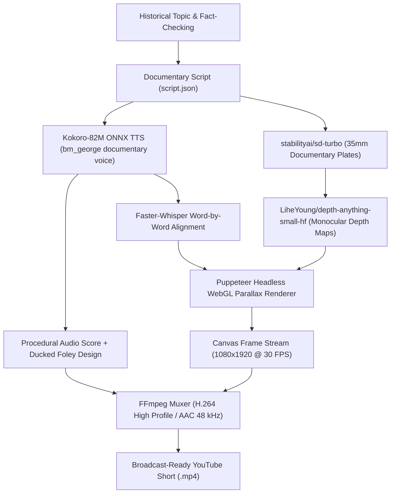

# Beyond History — Faceless Shorts AI Engine

> **100% Free, Local, Offline Historical Documentary Video Engine ($0.00 Cost, Zero Cloud APIs, No Subscriptions).**  
> Generates broadcast-quality, photorealistic vertical YouTube Shorts (1080×1920, 30 FPS, H.264 MP4) with 2.5D Depth-Displaced Parallax, Kokoro-82M AI voiceover, word-synced serif subtitles, and synchronized procedural Foley audio.

Official Channel: **[Beyond History (@Beyond_History_0)](https://www.youtube.com/@Beyond_History_0/shorts)**

---

## Architecture Overview



### Core Technologies ($0.00 Offline Stack)
1. **Narration:** Local **Kokoro-82M ONNX** (`bm_george` UK male documentary timbre) generating natural, solemn historical voiceover in ~4 seconds.
2. **Subtitles:** **Faster-Whisper** computing millisecond-accurate word boundaries, styled in high-contrast Roman serif typography with an imperial gold (`#F5D061`) active-word highlight within the YouTube Shorts lower-third safe zone.
3. **Photorealistic Visuals:** Local open-weight **Stable Diffusion Turbo** (`stabilityai/sd-turbo`) generating 35mm film grain historical plates (768×1024 base upscaled via Lanczos to 1080×1920).
4. **Cinematic 2.5D Parallax:** **Depth-Anything Small** (`LiheYoung/depth-anything-small-hf`) computing pixel-level depth displacement for realistic foreground/background motion in WebGL shaders.
5. **Sound Design:** Procedural multi-track audio score with dynamic dialogue ducking (-24 dBFS during narration) and synchronized Foley sound cues (clashing swords, firestorms, marching armies, creaking ship timbers).
6. **Rendering:** Headless Chrome WebGL canvas frame capture + **FFmpeg** encoding at 30.00 FPS constant H.264/AAC.

---

## Repository Structure

```text
faceless-shorts/
├── scripts/
│   ├── produce_history.py       # End-to-end automated documentary production pipeline
│   ├── produce_history.ps1      # PowerShell wrapper for produce_history
│   ├── voice.py                 # Kokoro-82M ONNX narration synthesizer
│   ├── words.py                 # Faster-Whisper word-by-word timestamp aligner
│   ├── local_image.py           # Local SD-Turbo image generator
│   ├── depth_estimator.py       # Local Depth-Anything monocular depth mapper
│   ├── new_video.ps1            # Project generator from style template
│   ├── setup_office_pc.ps1      # Automated office PC installer & hardware auditor
│   └── selftest.sh              # Engine diagnostic self-test
├── styles/
│   ├── beyond-history/          # Signature photorealistic 2.5D parallax historical style
│   ├── deep-dive/               # 3D procedural explainers ("What happens if...?")
│   ├── night-file/              # Unsolved mysteries & true crime in 3D rooms
│   ├── inside-out/              # 2D cross-section x-ray explainers
│   ├── stick-story/             # Survival guide stick animation
│   ├── paper-atlas/             # Animated historical paper maps
│   └── tall-tale/               # True funny stories in 3D
├── beyond-history-batch-01/     # Production Batch 01 (10 completed historical shorts)
├── requirements.txt             # Python dependency manifest
├── setup_office_pc.ps1          # Root setup script for easy deployment
├── .env.example                 # Environment configuration template
├── .gitignore                   # Excludes heavy renders, caches, venv, and weights
├── SKILL.md                     # Antigravity / Claude Agentic skill definition
└── README.md                    # Project documentation
```

---

## Office PC Setup Guide (Monday Installation)

Follow these steps to set up and run the engine on another Windows PC:

### 1. Prerequisites
- **Operating System:** Windows 10 / 11 (64-bit)
- **CPU:** Intel Core i5 / AMD Ryzen 5 or better (AVX2 support recommended)
- **RAM:** Minimum 8 GB (16 GB recommended)
- **Storage:** 15 GB free space for Python virtualenv and open-weight model caches
- **GPU (Optional):** NVIDIA GeForce / RTX GPU with CUDA 12.1+ support. If no dedicated GPU is detected, the engine runs in CPU inference mode.

### 2. Clone the Repository
Open PowerShell or Git Bash and clone the repository:
```powershell
cd C:\Users\<YourUsername>
git clone https://github.com/techwithsalman/faceless-shorts-video.git faceless-shorts
cd faceless-shorts
```

### 3. Run Automated Setup
Run the automated installer script. It will detect your office PC hardware, install missing tools (Python 3.11, Node.js LTS, FFmpeg), configure the Python virtual environment, and fetch the Kokoro voice model:
```powershell
powershell -ExecutionPolicy Bypass -File setup_office_pc.ps1
```

*Note on Model Cache:* If your office PC has a secondary drive (e.g. `D:\`), the setup script will automatically select `D:\faceless-shorts-ai\cache` to conserve Drive C:. You can also pass a custom cache location:
```powershell
powershell -ExecutionPolicy Bypass -File setup_office_pc.ps1 -CacheDir "E:\ai-models"
```

### 4. Verify Installation
Run a quick diagnostic check to verify that all components are operational:
```powershell
$venvPy = "$HOME\.faceless-shorts\venv\Scripts\python.exe"
& $venvPy scripts/voice.py --list
```
You should see the list of available Kokoro voices (including `bm_george`).

---

## How to Produce a Historical Short

### Method A: One-Command Production Pipeline
To produce a complete historical short from an existing project folder:
```powershell
$venvPy = "$HOME\.faceless-shorts\venv\Scripts\python.exe"
& $venvPy scripts/produce_history.py --project "path/to/my-project"
```

To create and produce a brand new short by topic title:
```powershell
& $venvPy scripts/produce_history.py --name "alexander-tyre" --topic "The Siege of Tyre: Alexander's Impossible Causeway"
```

### Method B: Modular Step-by-Step Production
1. **Scaffold Project:**
   ```powershell
   powershell -ExecutionPolicy Bypass -File scripts/new_video.ps1 beyond-history my-project
   ```
2. **Edit Script:**
   Edit `my-project/script.json` with 6 scenes, pacing (`speed: 1.15`), and visual prompts.
3. **Generate Voice Narration & Word Alignment:**
   ```powershell
   & $venvPy scripts/voice.py my-project
   & $venvPy scripts/words.py my-project
   ```
4. **Generate Scene Images & Depth Maps:**
   ```powershell
   & $venvPy scripts/local_image.py --project my-project
   & $venvPy scripts/depth_estimator.py --project my-project
   ```
5. **Synthesize Procedural Audio Score & Mix:**
   ```powershell
   cd my-project
   node tools/capture.mjs cues
   & $venvPy tools/mix.py .
   ```
6. **Render MP4 Video & Contact Sheet:**
   ```powershell
   node tools/capture.mjs video renders/my-project.mp4
   node tools/capture.mjs sheet review/my-project-contact.jpg 2.0 6
   ```

---

## Licenses & Model Attributions

All code, procedural sound designs, Three.js shaders, and scripts in this repository are original and 100% free for commercial use.
- **Kokoro-82M:** Apache-2.0 license (via `kokoro-onnx`, MIT).
- **Faster-Whisper:** MIT license (`Systran/faster-whisper` + OpenAI Whisper open weights).
- **Stable Diffusion Turbo:** Stability AI CreativeML Open RAIL-M / open-weight community license.
- **Depth-Anything:** Apache-2.0 license (`LiheYoung/depth-anything-small-hf`).
- **Typography:** Caladea (SIL Open Font License 1.1), Inter (SIL Open Font License 1.1).
