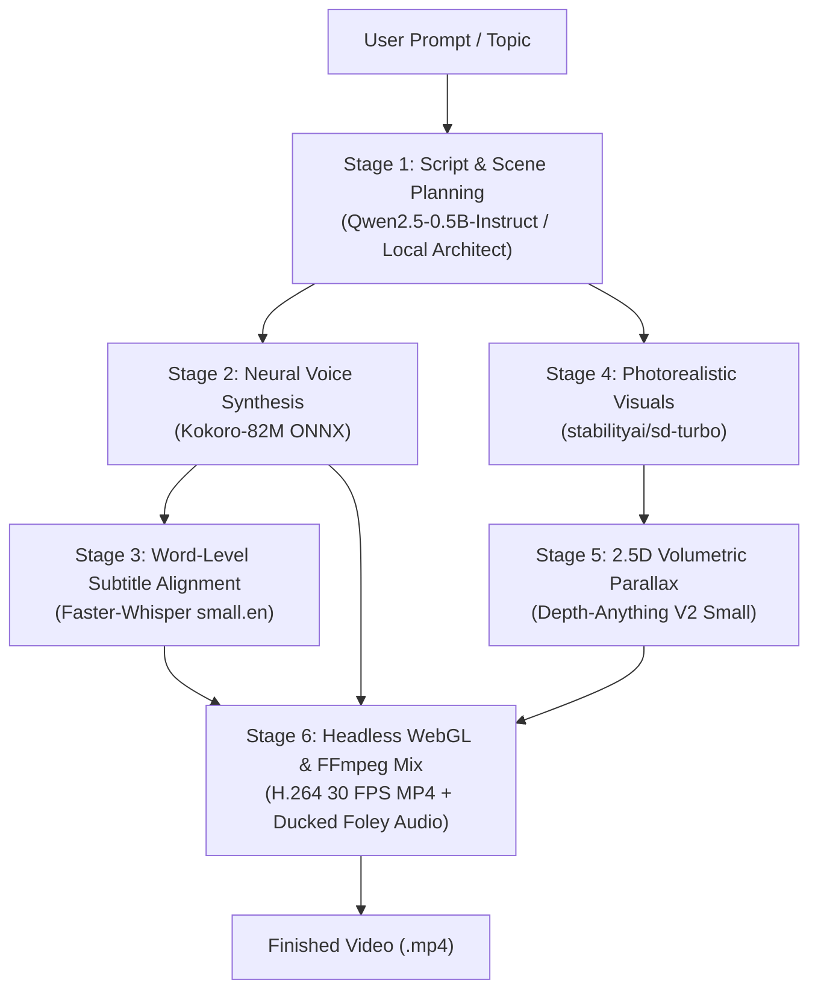

# Prompt2Video AI

> **Your Prompt. Your Video. Powered by Local AI.**  
> Transform natural language prompts into complete, narrated, synchronized, photorealistic videos on your Windows PC.  
> **100% Offline. $0.00 Cost. Zero Cloud APIs, Subscriptions, or Credit Cards.**

---

## ⚡ Overview

**Prompt2Video AI** is an independent, production-grade Windows desktop application that automates end-to-end short-form video creation using open-weight neural AI models running entirely on consumer hardware.

Enter any topic or concept: Prompt2Video AI plans the story script, synthesizes lifelike voiceover narration, aligns word-level subtitles, generates photorealistic visual plates, computes 2.5D volumetric parallax depth maps, and mixes procedural audio into a broadcast-ready H.264 MP4.

---

## 🖥️ Desktop Application Features

- **Modern Dark Studio UI**: Built with Electron, HTML5, CSS3, and JavaScript with an Electric Cyan and Amber dark palette.
- **Single Windows Installer**: Install via `Prompt2Video-AI-Setup.exe` with standard desktop shortcut and custom directory selection.
- **Flexible Aspect Ratios & Resolutions**:
  - `9:16 Vertical` (1080×1920 or 720×1280) for YouTube Shorts, Instagram Reels, and TikTok.
  - `16:9 Landscape` (1920×1080 or 1280×720) for standard YouTube and widescreen displays.
  - `1:1 Square` (1080×1080 or 720×720) for social feeds and square posts.
- **Target Duration Scaling**: 15s (Short), 30s (Standard), 45s (Story), or 60s (Deep Dive) with automatic scene count and word budgeting.
- **Multiple Timbre AI Voices**: Powered by local Kokoro-82M ONNX (Adam, George, Michael, Bella, Sarah).
- **Live Production Studio**: Watch real-time 6-stage pipeline progress, live generated scene cards, depth parallax badges, and live console logs.
- **Integrated Video Library**: Instant in-app playback with high-res HTML5 player and one-click "Show in Explorer" export.
- **AI Models & Hardware Health**: Real-time CPU, RAM, GPU, and storage inspection with offline model cache validation.

---

## 🧠 The 6-Stage Neural Pipeline ($0.00 Offline Stack)



1. **Stage 1 — Story Architecture (`local_llm.py`)**: Local instruction model formats high-retention 2-second opening hooks, narrative arcs, visual prompts, and Foley sound cues.
2. **Stage 2 — Voiceover Synthesis (`voice.py`)**: Kokoro-82M text-to-speech generates expressive, artifact-free speech in ~3-4 seconds.
3. **Stage 3 — Subtitle Timing (`words.py`)**: Faster-Whisper calculates millisecond-accurate word boundaries for high-impact highlighted subtitles.
4. **Stage 4 — Visual Plates (`local_image.py`)**: Stable Diffusion Turbo (`sd-turbo`) creates photorealistic 35mm-style historical and cinematic plates in 1 step.
5. **Stage 5 — Depth Parallax (`depth_estimator.py`)**: Depth-Anything generates dense monocular depth maps for dynamic camera movements and 3D depth displacement.
6. **Stage 6 — Video Mix & Render (`tools/capture.mjs`, `tools/mix.py`)**: Headless CDP WebGL renderer streams canvas frames to FFmpeg with procedural audio mixing and dialogue ducking.

---

## 🚀 Quickstart Guide

### 1. Launching via Desktop Application

1. Run the installer `Prompt2Video-AI-Setup.exe`.
2. Launch **Prompt2Video AI** from your desktop.
3. Enter your prompt (or pick a template pill like *Why the Titanic really sank*).
4. Select your duration, aspect ratio, and voice.
5. Click **Generate Video (100% Offline AI)**.

### 2. Launching via Command Line Interface (CLI)

```powershell
# Using the master orchestrator CLI
& "C:\Users\Abdulwahab\.faceless-shorts\venv\Scripts\python.exe" scripts/prompt2video.py `
  --prompt "The mysterious disappearance of the Mary Celeste in 1872" `
  --duration 30 `
  --aspect-ratio 9:16 `
  --resolution 1080p `
  --voice am_adam `
  --style cinematic-documentary
```

---

## 🛠️ System Requirements

| Specification | Minimum | Recommended |
| :--- | :--- | :--- |
| **OS** | Windows 10 (64-bit) | Windows 11 (64-bit) |
| **CPU** | Intel Core i5 / AMD Ryzen 5 (AVX2) | Intel Core i7 / AMD Ryzen 7+ |
| **RAM** | 8 GB | 16 GB |
| **GPU** | Integrated Intel HD 620 (CPU inference) | NVIDIA RTX (CUDA acceleration) |
| **Disk** | 10 GB Free | 20 GB Free (SSD) |

---

## 📦 Building from Source

To package the application into a Windows installer:

```powershell
# 1. Install Node.js build dependencies
npm install

# 2. Run in development
npm start

# 3. Compile Windows NSIS Installer (.exe)
npm run dist
```

See [BUILD_WINDOWS.md](file:///C:/Users/Abdulwahab/faceless-shorts/BUILD_WINDOWS.md) for full packaging details.

---

## 📄 Documentation

- [BUILD_WINDOWS.md](file:///C:/Users/Abdulwahab/faceless-shorts/BUILD_WINDOWS.md) — Packaging and NSIS installer guide.
- [INSTALLATION_GUIDE.md](file:///C:/Users/Abdulwahab/faceless-shorts/INSTALLATION_GUIDE.md) — End-user installation and first-run guide.
- [MODEL_SETUP_GUIDE.md](file:///C:/Users/Abdulwahab/faceless-shorts/MODEL_SETUP_GUIDE.md) — Offline model cache specifications and office PC migration.

---

## ⚖️ License

MIT License. Open-weight neural models retain their respective open licenses (Apache-2.0, MIT, Stability AI Non-Commercial Research Community License).
